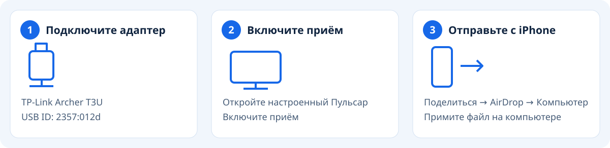
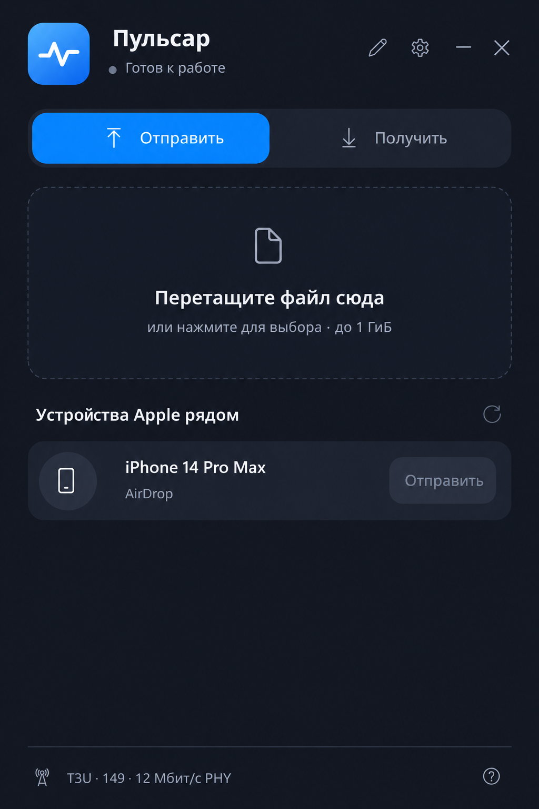
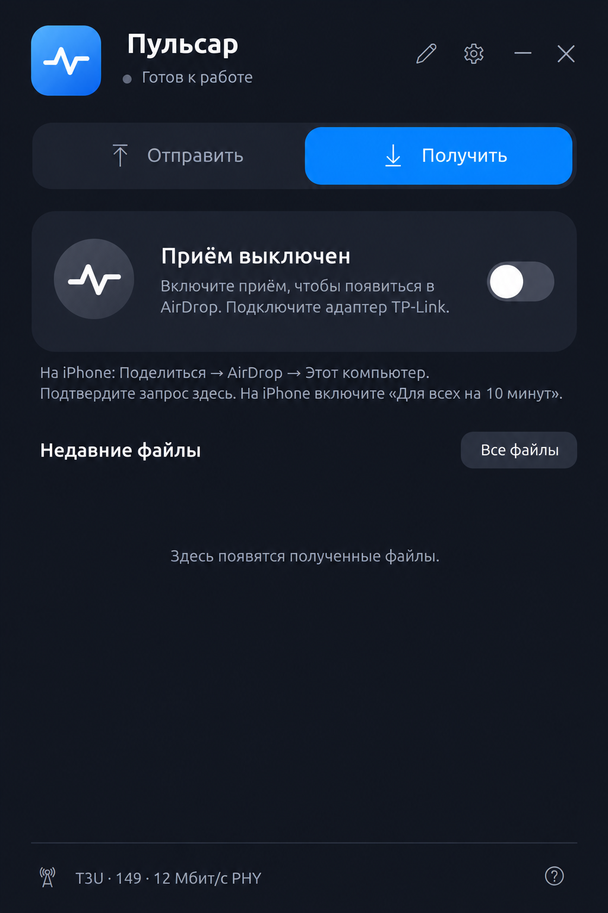

# Пульсар

**Обмен файлами между iPhone и Windows через AirDrop. Дополнительное приложение на iPhone не требуется.**

«Пульсар» — русская адаптация [PulseIt](https://github.com/gsl0001/windows-airdrop). Интерфейс, установщик и инструкции переведены на русский. Технические имена файлов программы используют `Pulsar`.

Это экспериментальная версия для разработки. Нужны конкретный USB-адаптер и первоначальная настройка с правами администратора. [Ограничения и результаты автора исходного проекта](docs/limitations.md) не являются результатами аппаратных испытаний этой адаптации.

## Что потребуется

| На компьютере | На iPhone |
| --- | --- |
| Windows x64; исходный проект проверялся на Windows 11 | Устройство рядом, экран разблокирован |
| **TP-Link Archer T3U с USB ID `2357:012d`** | AirDrop: **«Для всех на 10 минут»** |
| Работающий Bluetooth | Дополнительное приложение не нужно |
| Права администратора для настройки драйверов | Подтверждение входящих файлов |

Проверьте USB ID в Диспетчере устройств: одно название Archer T3U не подтверждает аппаратную ревизию. Пока адаптер работает с WinUSB для Пульсар, обычный Wi-Fi через него недоступен. Сохраните другой способ подключения к интернету. Установщик также настраивает виртуальный сетевой адаптер.

## Начало работы

1. Соберите тестовую версию по [инструкции для Windows](docs/build.md). Проверенного публичного установщика у этой адаптации пока нет.
2. Подключите поддерживаемый адаптер. Закройте Пульсар перед изменением драйверов. В установщике выберите настройку устройств и подтвердите запрос администратора.
3. Откройте **Пульсар** и включите приём.

### С iPhone на компьютер

1. Откройте фотографию, видео или файл на iPhone.
2. Нажмите **Поделиться → AirDrop → Этот компьютер** или имя, заданное в Пульсар.
3. Нажмите **«Принять»** на компьютере и дождитесь завершения.
4. Откройте **«Полученные файлы»**. Кнопка файла показывает его в Проводнике.

### С компьютера на iPhone

1. Разблокируйте iPhone и включите **AirDrop → «Для всех на 10 минут»**.
2. Откройте вкладку **«Отправить»** в Пульсар и обновите список устройств.
3. Выберите один файл и нажмите **«Отправить»** рядом с iPhone.
4. Подтвердите передачу на iPhone и дождитесь завершения.

Размер одного файла — до **1 ГиБ**. Держите устройства рядом и не выключайте приём во время передачи. Базовый режим использует фиксированный канал 149. **«Совместимая отправка (12 Мбит/с)»** снижает скорость и предназначена для проверки нестабильного соединения; автоматический выбор канала оставьте выключенным при первоначальной проверке.

## Интерфейс

Иллюстрации показывают русскую версию интерфейса с вымышленными данными. Они не подтверждают обнаружение настоящего устройства или успешную передачу.

<table><tr><td align="center"><strong>Отправка файла</strong> </td><td align="center"><strong>Получение файлов</strong> </td></tr></table>

## Если что-то не работает

| Проблема | Что проверить |
| --- | --- |
| iPhone не появился | Разблокируйте его, обновите режим «Для всех на 10 минут» и список в Пульсар. |
| Компьютера нет в AirDrop на iPhone | Включите приём, проверьте подключение адаптера и заново откройте меню AirDrop. |
| Предлагается восстановление Bluetooth | Оно может ненадолго отключить аксессуары. Запускайте, когда такое прерывание допустимо. |
| Передача приостановилась | Оставьте устройства рядом и разблокированными. Большие файлы могут передаваться с паузами. |
| Передача завершилась с ошибкой | Отмените попытку, обновите режим «Для всех» и список устройств, затем повторите. |
| Нужно вернуть обычный Wi-Fi | Закройте Пульсар и выберите **«Восстановить драйвер Wi-Fi»** в меню «Пуск». Восстановление на чистом ПК ещё требует проверки. |

В отчёте об ошибке укажите версию, USB ID, направление передачи, размер файла и результат на обоих устройствах. Экспорт диагностики может содержать имена, адреса и пути к файлам: просмотрите и обезличьте его перед публикацией. Не публикуйте ключи, личные файлы и необработанные записи трафика.

## Скорость и состояние проекта

Автор исходного PulseIt сообщил о повторной передаче 80 МБ с iPhone за 14–20 секунд, примерно 4–6 МБ/с. Эти значения зависят от устройства, его подключения к Wi-Fi и выделяемого AirDrop эфирного времени; они не гарантируют скорость Пульсар. Приём использует полосу 80 МГц, упорядочивание Block Ack, подтверждения 54 Мбит/с и сокращённое ожидание завершения загрузки. Параметры `--width20` и `--no-rx-aggregation` возвращают прежние режимы для диагностики.

В более ранних сборках источника работала отправка на iPhone, включая видео 135,6 МБ. Исправление запуска 0.2.7 прошло десять циклов включения и выключения адаптера. Отправку текущей версии, длительную работу, совместную работу Bluetooth, установку на чистый ПК и восстановление драйвера нужно проверять отдельно. **Режим «Только для контактов» не поддерживается.** Проверка учётной записи Apple не реализована.

Сборка Пульсар **не подписана**. У адаптации нет подтверждённого участия в SignPath. Исторические сведения о заявке автора PulseIt относятся к исходному проекту.

## Разработка

| Каталог | Назначение |
| --- | --- |
| `desktop/` | Интерфейс Windows и управление процессами |
| `airdrop/` | Обнаружение по HTTPS, подтверждение и потоковая передача файлов |
| `sched/`, `compat/`, `netif/` | Планировщик OWL и виртуальная сеть |
| `radio/` | Отдельный USB-радиомост и транспорт именованного канала |
| `tools/`, `installer/` | Сборка и настройка устройств |
| `assets/`, `tests/`, `patches/` | Графика, тесты и исправления исходных компонентов |

[Сборка на Windows](docs/build.md) · [Облачная среда Linux](docs/cloud-environment.md) · [Происхождение кода](docs/upstream-import.md) · [Архитектура](docs/architecture.md) · [Участие в разработке](CONTRIBUTING.md)

По умолчанию исходники распространяются по GPL-3.0-or-later; отдельные части имеют GPL-2.0-only и MIT. [Карта лицензий](LICENSE) и [уведомления об авторах](THIRD_PARTY_NOTICES.md) сохранены. OWL и devourer остаются отдельными процессами.

[Сообщить об уязвимости](SECURITY.md) · [Конфиденциальность](PRIVACY.md) · [Подпись сборок](CODE-SIGNING.md)

Независимый проект, не связанный с Apple, TP-Link, OpenIPC и авторами OWL. Названия сторонних продуктов принадлежат их владельцам.
